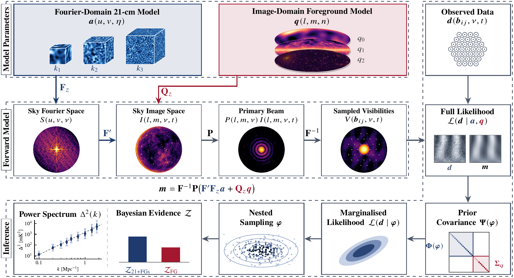

<h1 align="center">
  <picture>
    <source media="(prefers-color-scheme: dark)" srcset="docs/assets/branding/wordmark-dark.svg">
    
  </picture>
</h1>

**BayesEoR** is a physically motivated forward-modelling framework for Bayesian
recovery of the 21-cm power spectrum from interferometric visibilities. Contributions to
the data are modelled jointly and propagated through the instrument
response, so the recovered power spectrum and Bayesian evidence reflect their
combined uncertainty.

This version is written in JAX and runs on CPU or GPU, with optional distributed
GPU linear algebra through [JAXMg](https://flatironinstitute.github.io/jaxmg/latest/).

<picture>
  <source media="(prefers-color-scheme: dark)" srcset="docs/assets/diagrams/workflow-dark.png">
  
</picture>

## Documentation

Documentation is kept within this private repository and is not publicly hosted.
To view it locally, run from the repository root:

```bash
python -m pip install -e ".[docs]"
python -m mkdocs serve --dev-addr 127.0.0.1:8000
```

Open `http://127.0.0.1:8000`, or browse the source pages below:

- **[Home](docs/index.md):** how BayesEoR works, installation, getting started
  and citations.
- **[Data](docs/data/index.md):** interferometric visibilities, and the instrument
  and observation that describe them.
- **[Model](docs/model/index.md):** the EoR and foreground forward models, and the
  KL reduced basis.
- **[Inference](docs/inference/index.md):** the power-spectrum prior, analytical
  marginalisation, nested sampling and posterior analysis.
- **[Examples](docs/examples/index.md):** two worked analyses, 21-cm only and
  21-cm with foregrounds.
- **[API](docs/api/index.md):** the Python reference, generated from the source.

## Installation

Through JAX and JAXMg, BayesEoR scales from a single desktop computer to multi-GPU
HPC clusters. The models, likelihood and sampler are the same in every case; only
the linear-algebra backend changes.

Clone the repository, then create the environment matching your system:

```bash
git clone https://github.com/JacobTutt/BayesEoR-JAX.git
cd BayesEoR-JAX
```

**Desktop or CPU workstation**

```bash
conda env create -f environment.yml
conda activate bayeseor
```

**Linux NVIDIA GPU cluster**

```bash
conda env create -f environment-hpc.yml
conda activate bayeseor-hpc
```

Both environments use Python 3.12 or newer and JAX 0.11.1 or newer. On GPU clusters,
the dense linear algebra is distributed across devices with JAXMg, which is built on
NVIDIA's cuSOLVERMp, so the GPU environment is restricted to NVIDIA systems. See the
[installation guide](docs/installation.md) for details.

## Getting started

The quickest way to get started is to run one of the two examples. Each infers a
21-cm power spectrum from a small simulated observation, and takes a few minutes
on a laptop. From the repository root:

```bash
# 21-cm only
python -m examples.eor.run --sample

# 21-cm and foregrounds
python -m examples.eor_fgs.run --sample
```

Without `--sample`, each example stops after setup, which is a quick check that
the installation works. Each writes its power-spectrum and posterior figure to its
`plots/` folder, for example `examples/eor/plots/power_spectrum_and_posteriors.png`,
and its full outputs under `outputs/`. See the
[examples](docs/examples/index.md) for a walkthrough of each.

## Citing BayesEoR

If you use BayesEoR-JAX, please cite the papers relevant to your analysis,
together with the software paper. See [Citing BayesEoR](docs/citing.md) for each
reference and its BibTeX.
