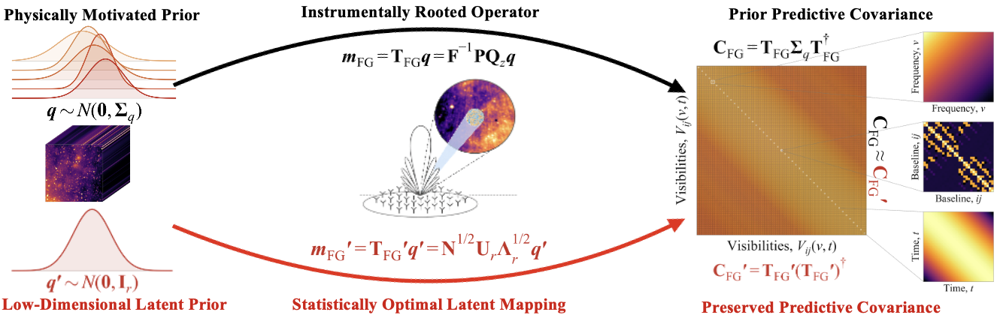

# KL Reduced Basis

The Karhunen–Loève (KL) reduced basis is a general compression for any linear
model component with a Gaussian prior, equivalent to an optimal low-rank
approximation of a Bayesian linear inverse problem (Spantini et al. 2015). It
propagates the component's physically
motivated structure through to its prior-predictive covariance in visibility
space, and represents that covariance in an orthogonal basis ordered by how far
each mode rises above the noise. Modes the data cannot distinguish from noise are
then discarded.

[](../assets/diagrams/latent-compression.png)

For a component $\boldsymbol m = \mathbf T\boldsymbol x$ with prior
$\boldsymbol x \sim \mathcal N(\boldsymbol 0, \mathbf\Sigma)$, the compression
proceeds as

$$
\mathbf T
\ \longrightarrow\
\mathbf A=\mathbf N^{-1/2}\mathbf T\,\mathbf\Sigma^{1/2}
\ \longrightarrow\
(\mathbf U,\mathbf S)
\ \longrightarrow\
\mathbf T_r .
$$

Because the coefficients are marginalised analytically, the inference depends only
on the uncertainty they induce in the visibilities,
$\mathbf C = \mathbf T\mathbf\Sigma\mathbf T^\dagger$, not on the coefficients
themselves. Any basis spanning $\mathbf C$ is therefore equivalent, and the
reduced operator, $\mathbf T_r$, replaces $\mathbf T$ in the same visibility
space with far fewer columns.

The pipeline currently applies this to the [foreground model](foregrounds.md),
whose physical basis is the largest. The same construction could be applied to
the [EoR model](eor.md) independently within each $k$ bin, keeping the
power-spectrum amplitudes as sampled parameters.

## 1. Weight the mapping by prior and noise

Each coefficient is scaled by its prior standard deviation, and each visibility by
its inverse noise RMS, so that the operator's response is measured relative to the
noise.

=== "Maths"

    $$
    \mathbf A=\mathbf N^{-1/2}\mathbf T\,\mathbf\Sigma^{1/2},
    \qquad
    \mathbf C_w = \mathbf N^{-1/2}\mathbf C\,\mathbf N^{-1/2} = \mathbf A\mathbf A^\dagger.
    $$

    $\mathbf C_w$ is the prior-predictive covariance in noise-whitened visibility
    space. For diagonal priors and noise, each column of $\mathbf T$ is multiplied by
    its prior standard deviation and each row divided by its noise RMS.

=== "Code"

    [weight_foreground_operator](../api/operators.md#bayeseor_jax.model.operators.weight_foreground_operator)
    applies these factors to an existing operator, and
    [T_fg_weighted](../api/operators.md#bayeseor_jax.model.operators.T_fg_weighted)
    constructs and weights a visibility block directly.

    For a full analysis,
    [T_fg_weighted_build_save](../api/construction.md#bayeseor_jax.model.construction.operator_construction.T_fg_weighted_build_save)
    builds $\mathbf A$ in CPU blocks and saves it as `A_fg.npy`, without first
    saving the unweighted operator.

## 2. Decompose the weighted operator

A singular-value decomposition of $\mathbf A$ gives an orthonormal set of
visibility-space modes, each with a variance measured relative to the noise.

=== "Maths"

    $$
    \mathbf A=\mathbf U\mathbf S\mathbf V^\dagger,
    \qquad
    \mathbf C_w = \mathbf U\mathbf S^2\mathbf U^\dagger.
    $$

    The columns of $\mathbf U$ are the KL modes, and $\lambda_i = s_i^2$ is the
    prior-predictive variance of each relative to the noise. An eigendecomposition
    of $\mathbf C_w$ gives the same modes; the operator form is smaller when there
    are fewer coefficients than visibilities. The number of modes is bounded by

    $$
    r \leq \operatorname{rank}(\mathbf C) \leq \min(N_{\rm d}, N_{\rm param}),
    $$

    and keeping the largest modes minimises the discarded whitened variance for any
    given rank, which is the sense in which the basis is statistically optimal.

=== "Code"

    [T_fg_svd_build_save](../api/construction.md#bayeseor_jax.model.construction.kl_reduction.T_fg_svd_build_save)
    performs the decomposition, truncation and rescaling of steps 2 to 4 in one call.
    It uses an exact, thin SVD of $\mathbf A$:

    - **CPU:** native JAX on a single device. $\mathbf A$, $\mathbf U$ and the
      workspace must fit in RAM.
    - **GPU:** distributed with [JAXMg](https://flatironinstitute.github.io/jaxmg/latest/),
      with one process per GPU and shared storage.

## 3. Choose the retained rank

The modes are truncated once the variance left over is a small fraction of the
noise, so the reduced basis preserves the component's uncertainty to that level.

=== "Maths"

    With the singular values ordered from largest to smallest, keep the smallest $r$
    satisfying

    $$
    \epsilon_{\rm RMS}(r)
    =\left[\frac{1}{N_{\rm d}}\sum_{i>r}s_i^2\right]^{1/2}
    \leq f.
    $$

    The default $f = 0.1$ limits the discarded prior-predictive RMS, averaged over
    the visibilities, to ten per cent of the noise RMS. It is not a bound on every
    individual visibility.

=== "Code"

    [select_foreground_rank](../api/construction.md#bayeseor_jax.model.construction.kl_reduction.select_foreground_rank)
    implements this criterion, and is called by `T_fg_svd_build_save` through its
    `f` argument.

## 4. Restore visibility units

The retained modes are un-whitened, keeping the prior absorbed into them, to give
the reduced operator.

=== "Maths"

    $$
    \mathbf T_r=\mathbf N^{1/2}\mathbf U_r\mathbf S_r,
    \qquad
    \boldsymbol m^{(r)}=\mathbf T_r\boldsymbol z,
    \qquad
    \boldsymbol z \sim \mathcal N(\boldsymbol 0, \mathbf I_r).
    $$

    The latent coefficients, $\boldsymbol z$, have a standard-normal prior by
    construction, and the retained covariance is
    $\mathbf C^{(r)}=\mathbf T_r\mathbf T_r^\dagger$.

=== "Code"

    ```python
    from bayeseor_jax import T_fg_svd_build_save

    reduced_path = T_fg_svd_build_save(
        "arrays/A_fg.npy",
        "arrays/Ninv.npy",
        output_path="arrays/T_fg_reduced.npy",
        f=0.1,
    )
    ```

    `Ninv.npy` must be the inverse noise used to build $\mathbf A$. The routine also
    saves the singular values, `T_fg_reduced.singular_values.npy`, and the truncation
    diagnostics, `T_fg_reduced.svd.json`.

## Building through setup

To construct the basis and likelihood in one pipeline call, set
`foreground_kl_path` in the configuration and run:

```python
from bayeseor_jax import run_setup

setup = run_setup(config, build_foreground_kl=True, kl_f=0.1)
```

Setup resolves the observation once, saves the prior- and noise-weighted
`A_fg.npy`, and calls `T_fg_svd_build_save` to save the reduced operator and
its diagnostics. Joint assembly then uses its standard-normal latent prior.
This explicitly rebuilds the KL basis; omit `build_foreground_kl` to reuse an
existing basis for the same observation, noise and foreground prior.

## Configuration

`foreground_kl_path`
:   A saved reduced operator, used in place of the physical foreground model.

    - **Effect:** its columns are used with a unit prior. By default setup loads
      the saved basis unchanged; `foreground_prior_std_mk` is not applied again.
    - **Requires:** `model: fg` or `model: eor+fg`.
    - **Note:** the operator must match the observation, visibility ordering and
      foreground prior it was built from. Shape checks alone cannot confirm this.

See [execution](construction.md#execution) for the CPU and distributed-GPU workflow.
