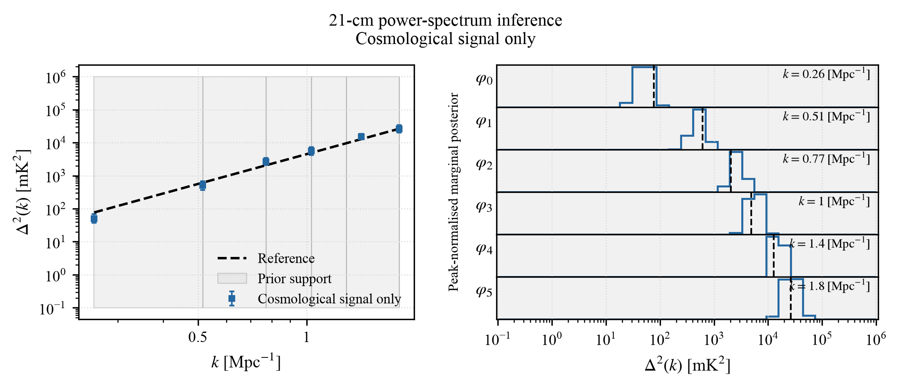

# 21-cm only

Infer the power spectrum of a simulated 21-cm signal, observed by a 37-antenna
HERA-like array over 15 channels and 15 integrations, with no foregrounds. The
example adds seeded thermal noise, builds the EoR model and recovers the injected
power spectrum with MultiNest.

The full walkthrough, including the data, configuration and results, is in the
documentation: [21-cm only](../../docs/examples/eor.md).

## Run

From the repository root, after [installation](../../docs/installation.md):

```bash
python -m examples.eor.run --sample
```

Omit `--sample` to stop after setup. Outputs are written to
`outputs/laptop_eor_nside128/`, and the figure below to `plots/`.

```text
eor/
├── config.yaml     # run configuration
├── run.py          # entry point
├── data/           # noiseless visibilities, instrument model, injected P(k)
└── plots/          # posterior summary and figure
```

## Result

All six power-spectrum bins recover the injected spectrum (dashed) within their 95%
credible intervals.


