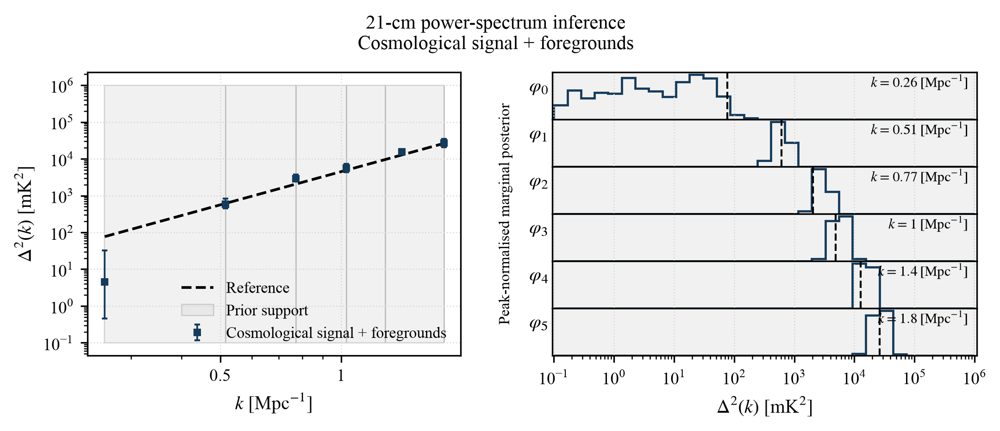

# 21-cm and foregrounds

Add GSM2008 diffuse emission and bright point sources to the same simulated 21-cm
signal and observation as the [21-cm only](../eor/README.md) example. Setup
compresses the foregrounds into a KL reduced basis, retaining 179 of 1,248
coefficients, before the power spectrum is inferred jointly with them.

The full walkthrough, including the data, configuration and results, is in the
documentation: [21-cm and foregrounds](../../docs/examples/eor-fgs.md).

## Run

From the repository root, after [installation](../../docs/installation.md):

```bash
python -m examples.eor_fgs.run --sample
```

Omit `--sample` to stop after setup, including the KL construction. Outputs are
written to `outputs/laptop_eor_fgs_nside128/`, with the reduced basis under `kl/`,
and the figure below to `plots/`.

```text
eor_fgs/
├── config.yaml     # run configuration
├── run.py          # entry point
├── data/           # noiseless visibilities, instrument model, injected P(k)
└── plots/          # posterior summary and figure
```

## Result

The five highest-$k$ bins are recovered as in the 21-cm only example. The lowest
bin, where the signal is most degenerate with the smooth foregrounds, becomes
unconstrained from below, with the injected value still inside its 95% interval.


